<h1 align="center">homelab</h1>

<p align="center">
  
  
  
  
  
  
</p>

A personal homelab built as **independent Docker Compose stacks, versioned in Git and deployed by [Dockhand](https://github.com/Finsys/dockhand)**. Every app is reached by a friendly name (`jellyfin.casa.home`) from any device at home, behind one shared login. The whole setup is designed to move from today's Windows PC to an always-on mini PC by copying one folder.

<picture>
  <source media="(prefers-color-scheme: dark)" srcset="docs/architecture-dark.png">
  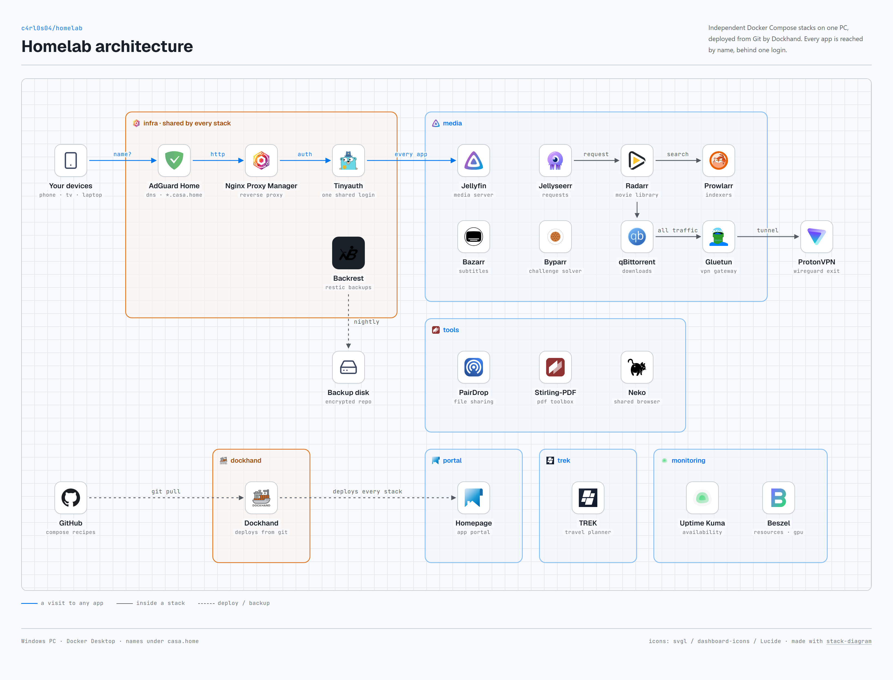
</picture>

## Highlights

- **Git is the source of truth.** Each stack is a folder with one `compose.yaml`. Dockhand pulls it from GitHub and deploys it, and secrets stay encrypted in Dockhand, never in Git.
- **Names, not ports.** AdGuard answers every `*.casa.home` name with the server's address. Nginx Proxy Manager then sends each name to the right container.
- **One login for everything.** Tinyauth sits in front of the admin UIs. Their own logins are switched off and their ports listen only on `127.0.0.1`, so nobody on the network can go around it.
- **Downloads only through the VPN.** qBittorrent has no network of its own: it shares Gluetun's, and Gluetun only lets traffic out through the ProtonVPN WireGuard tunnel. A sidecar keeps the forwarded port in sync.
- **Watched and backed up.**
  - Uptime Kuma checks 17 services every minute.
  - Beszel keeps CPU, memory and GPU history for the host and each container.
  - Backrest makes encrypted, deduplicated backups of all app data every night to a second disk.
- **Portable by design.** Compose files hold no host paths: every path comes from a variable (`DATA_ROOT`, `MEDIA_ROOT`, `BACKUP_ROOT`).

## Built with

<table>
  <tr>
    <td align="center" width="110"><br><b>Docker</b><br><sub>runtime</sub></td>
    <td align="center" width="110">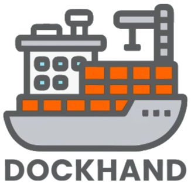<br><b>Dockhand</b><br><sub>git deploys</sub></td>
    <td align="center" width="110"><br><b>GitHub</b><br><sub>stack recipes</sub></td>
    <td align="center" width="110"><br><b>AdGuard Home</b><br><sub>dns · ad block</sub></td>
    <td align="center" width="110"><br><b>Nginx Proxy Manager</b><br><sub>names → apps</sub></td>
    <td align="center" width="110"><br><b>Tinyauth</b><br><sub>one login</sub></td>
  </tr>
  <tr>
    <td align="center"><br><b>Jellyfin</b><br><sub>media server</sub></td>
    <td align="center"><br><b>Jellyseerr</b><br><sub>requests</sub></td>
    <td align="center"><br><b>Radarr</b><br><sub>movie library</sub></td>
    <td align="center"><br><b>Prowlarr</b><br><sub>indexers</sub></td>
    <td align="center"><br><b>Bazarr</b><br><sub>subtitles</sub></td>
    <td align="center">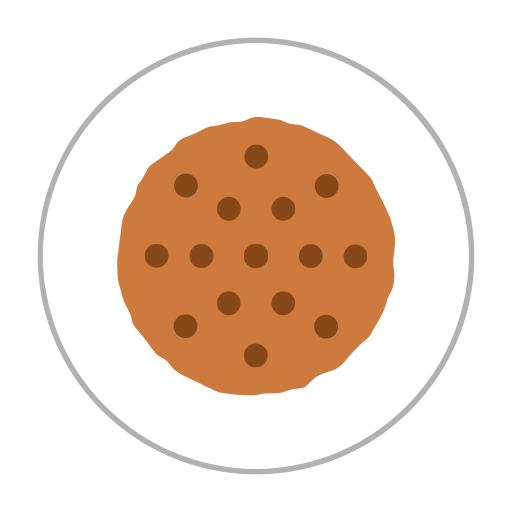<br><b>Byparr</b><br><sub>challenge solver</sub></td>
  </tr>
  <tr>
    <td align="center"><br><b>qBittorrent</b><br><sub>downloads</sub></td>
    <td align="center">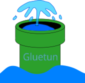<br><b>Gluetun</b><br><sub>vpn gateway</sub></td>
    <td align="center"><br><b>ProtonVPN</b><br><sub>wireguard exit</sub></td>
    <td align="center"><br><b>Uptime Kuma</b><br><sub>availability</sub></td>
    <td align="center"><br><b>Beszel</b><br><sub>resources · gpu</sub></td>
    <td align="center"><br><b>Backrest</b><br><sub>restic backups</sub></td>
  </tr>
  <tr>
    <td align="center"><br><b>Homepage</b><br><sub>portal</sub></td>
    <td align="center"><br><b>TREK</b><br><sub>travel planner</sub></td>
    <td align="center"><br><b>PairDrop</b><br><sub>file sharing</sub></td>
    <td align="center"><br><b>Stirling-PDF</b><br><sub>pdf toolbox</sub></td>
    <td align="center"><br><b>Neko</b><br><sub>shared browser</sub></td>
    <td align="center"></td>
  </tr>
</table>

## What happens when you open an app

1. A phone asks the home DNS (**AdGuard**) for `radarr.casa.home`. A wildcard rule answers with the server's LAN address.
2. The browser connects to **Nginx Proxy Manager** on port 80. It maps the name to a container on the shared Docker network `proxy`.
3. Before forwarding, Nginx asks **Tinyauth** whether the browser has a valid session (`auth_request`). If not, it redirects to `auth.casa.home` and comes back after the login. The session cookie covers all of `casa.home`, so you log in once.
4. The request reaches **Radarr**, whose own login is off. Its port listens only on `127.0.0.1`, so the only way in from the network is through steps 2 and 3.

Jellyfin, Jellyseerr and TREK keep their own accounts, because TV apps and other people use them. PairDrop is open to every device at home.


## A tour of the stacks

Each stack is one folder under [`stacks/`](stacks) with its own README: variables, the data it owns, how it is backed up and a dated checklist of what has been verified.

### `dockhand`: the control panel

[Dockhand](https://github.com/Finsys/dockhand) is the only stack started by hand. Every other stack is registered in it as a **Git stack**: Dockhand clones this repository, reads `stacks/<name>/compose.yaml` and deploys it with that stack's variables. Variables marked secret are stored encrypted. Changing the homelab means editing a Compose file, pushing it and pressing *sync*.

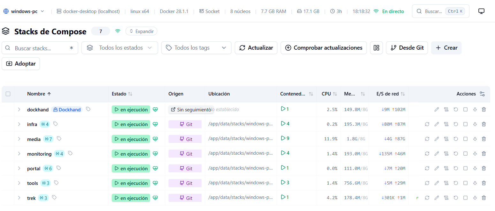

### `infra`: names, login and backups

Shared by every other stack, which joins its Docker network `proxy`.

- **AdGuard Home** is the home DNS. It blocks ads for every device, and a wildcard rule answers every `*.casa.home` name with the server's address.
- **Nginx Proxy Manager** sends each name to its container: `beszel.casa.home → beszel:8090`, and so on.
- **Tinyauth** is the one login in front of the admin UIs. Nginx asks it before serving a protected name, and one session works for all of them.
- **Backrest** runs [restic](https://restic.net) every night. It makes encrypted, deduplicated backups of all app data to a second disk, keeping 24 hourly, 30 daily and 12 monthly copies.

<table>
  <tr>
    <td width="50%">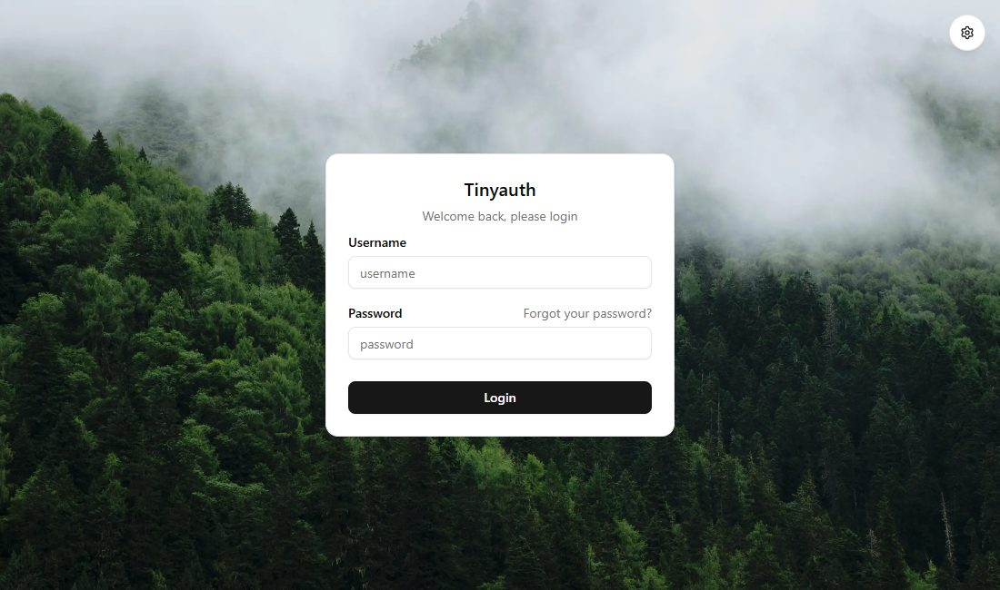</td>
    <td width="50%">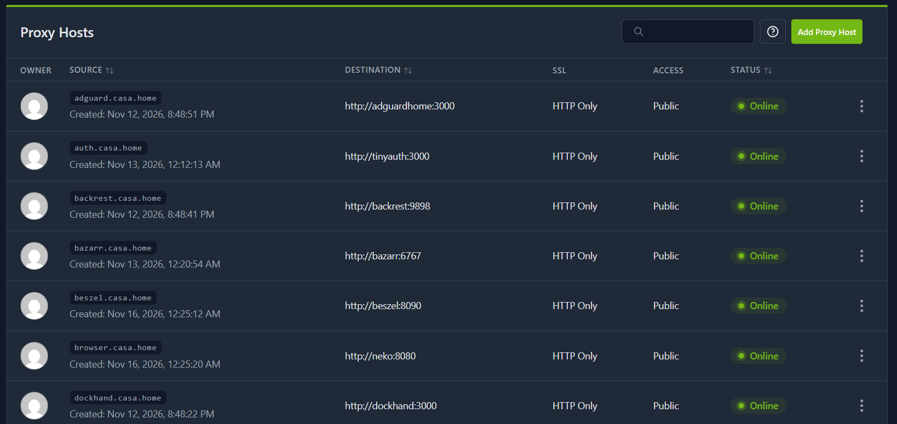</td>
  </tr>
  <tr>
    <td align="center"><sub><b>Tinyauth</b>: the shared login page</sub></td>
    <td align="center"><sub><b>Nginx Proxy Manager</b>: one name per app, mapped to a container</sub></td>
  </tr>
  <tr>
    <td colspan="2">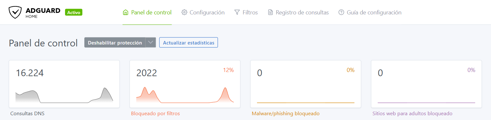</td>
  </tr>
  <tr>
    <td colspan="2" align="center"><sub><b>AdGuard Home</b>: about 12 % of all lookups are ads or trackers, blocked for every device</sub></td>
  </tr>
  <tr>
    <td colspan="2" align="center">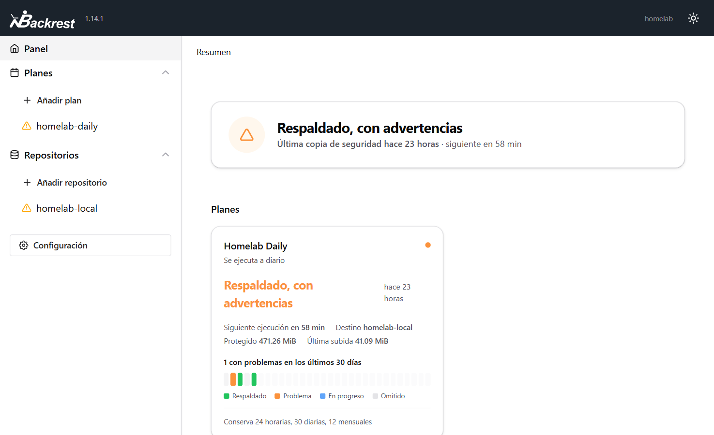</td>
  </tr>
  <tr>
    <td colspan="2" align="center"><sub><b>Backrest</b>: the nightly plan, its 30-day history and recent runs</sub></td>
  </tr>
</table>

### `media`: films, from request to screen

A small pipeline where each app does one job:

1. **Jellyseerr**: someone asks for a film.
2. **Radarr** takes the request and asks **Prowlarr** to search the configured indexers. **Byparr** solves the Cloudflare challenges some of them show.
3. Radarr sends the best result to **qBittorrent**. qBittorrent has no network of its own: it lives inside **Gluetun**, whose firewall lets traffic out only through the ProtonVPN WireGuard tunnel. If the VPN drops, downloads stop instead of leaking. A small sidecar keeps qBittorrent's listening port equal to the one ProtonVPN forwards.
4. When the download finishes, Radarr renames the film and files it into the library. **Bazarr** adds subtitles.
5. **Jellyfin** streams it to the TV, phones and browsers.

### `monitoring`: is it up, and what is it using

- **Uptime Kuma** checks all 17 services every minute by container name. It also publishes a status page.
- **Beszel** keeps the history of CPU, memory, disk, network and GPU for the host and for every container. Its agent reads Docker through a read-only socket proxy, never the socket itself.

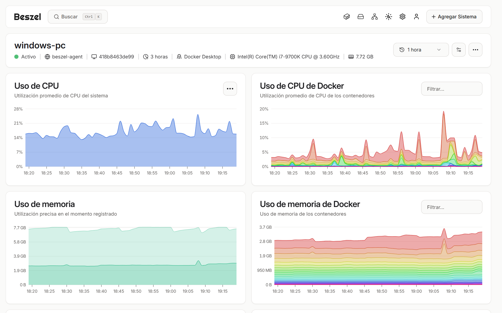

<p align="center"><br><sub><b>Uptime Kuma</b>: the public status page</sub></p>

### `portal`: one page for everything

[Homepage](https://gethomepage.dev) with a custom glass theme and live widgets. It is configured entirely inside its `compose.yaml`: settings, services, custom CSS and a small script. The ⓘ on each card opens a panel explaining that app: what it does, its stack, its login and its addresses.

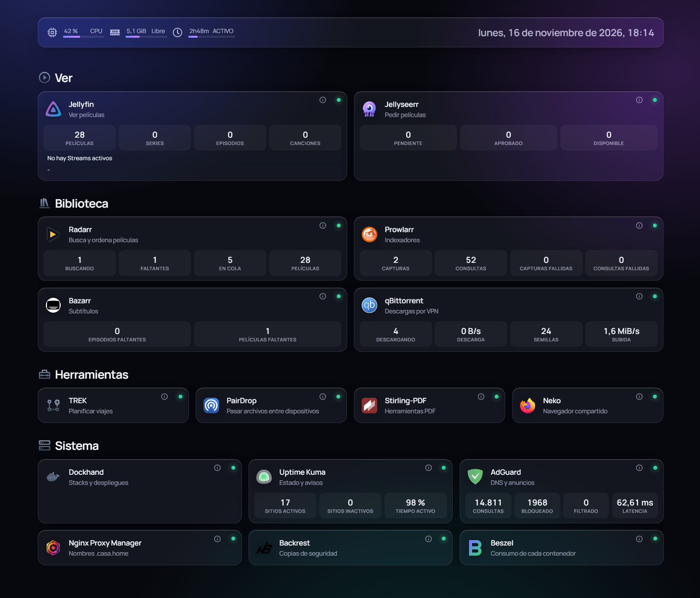

### `tools`: small everyday utilities

- **Stirling-PDF**: merge, split, compress, sign and OCR PDFs (with Spanish OCR), without uploading them anywhere.
- **PairDrop**: AirDrop for every device at home; files go device to device over WebRTC.
- **Neko**: a Firefox running in a container and streamed to any device over WebRTC. Several people can share it, and it starts clean on every deploy. It is kept but switched off by default (a Compose profile): over this network it was too slow for daily use.

<table>
  <tr>
    <td width="50%">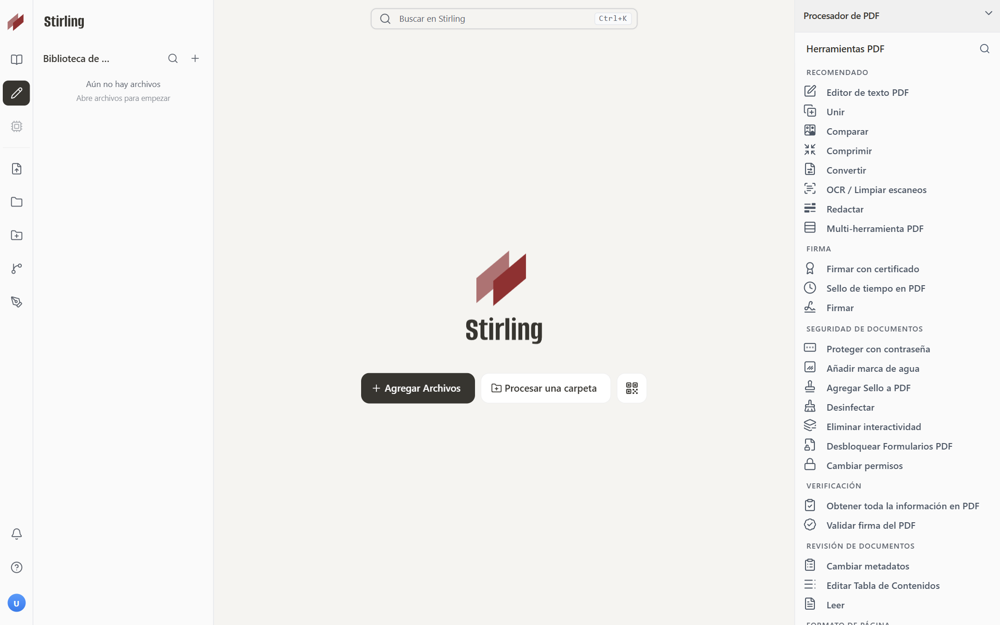</td>
    <td width="50%">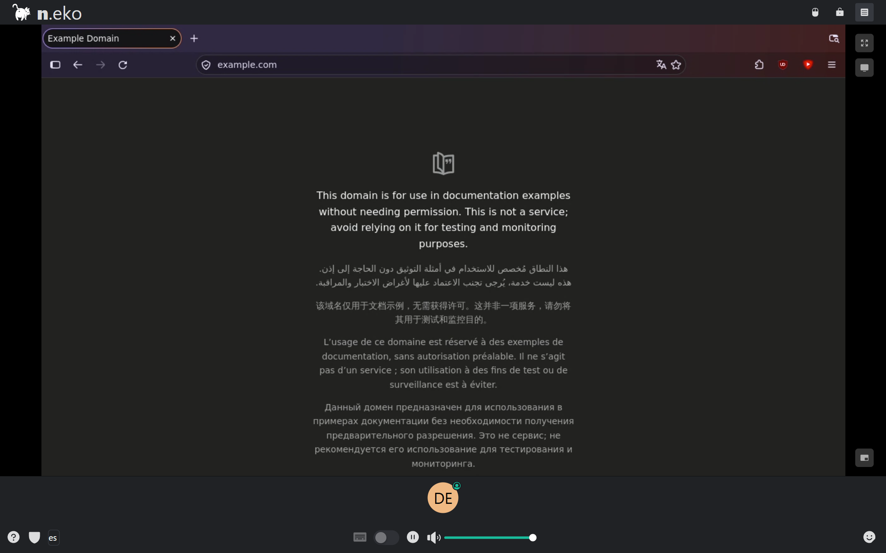</td>
  </tr>
  <tr>
    <td align="center"><sub><b>Stirling-PDF</b>: every PDF tool, running locally</sub></td>
    <td align="center"><sub><b>Neko</b>: Firefox in a container, in your browser</sub></td>
  </tr>
</table>

### `trek`: travel planning

[TREK](https://github.com/liketrek/TREK) plans trips: days, places on a map, bookings, budget and packing lists, shared with other travellers. It keeps its own accounts because other people use it too, and it exposes an MCP endpoint so trips can also be planned from an assistant.

## Design decisions

- **Independent stacks over one big Compose file.** Each stack can be redeployed, stopped or moved on its own. Shared pieces (DNS, proxy, login) live in `infra`. Monitoring is separate so it keeps watching while other stacks restart.
- **A ready-made manager, not custom tooling.** An earlier version of this project was a hand-built control panel. Dockhand already does Git deploys, encrypted per-stack variables and logs, so the custom code was retired.
- **Secrets never touch Git.** Compose files refer to `${VARIABLES}`. Real values sit in Dockhand, encrypted, and in one private host file for Dockhand itself.
- **Pinned images.** Every image uses a fixed version or digest, so a redeploy never pulls a surprise.
- **Guard rails learnt the hard way.**
  - Every container caps its logs at 3 × 10 MB.
  - Services that can spike (TREK, Neko, Byparr) are limited to 2 CPU cores, after a runaway process once starved the proxy and the login.
  - Gluetun's health check waits up to 2 minutes, so qBittorrent never starts before the VPN is up.
- **Backups of data, not of configuration exports.** Backrest copies all of `DATA_ROOT`, which holds every app database. A restore test checked the restored files byte by byte.

## Repository layout

```text
stacks/<name>/
  compose.yaml   # pinned images, variables only: no secrets, no host paths
  .env.example   # variable names with safe example values (when needed)
  README.md      # variables, data, backup and a dated checklist
hosts/
  example.env    # template for host-specific values; real host files stay private
docs/
  architecture.html   # self-contained source of the diagram (open it in a browser)
  *.png               # diagram and screenshots used in this README
```

On the host, the repository, data and media share one folder. Backups go to another disk:

```text
homelab/
  repo/    # this repository
  data/    # DATA_ROOT: app databases and settings, Dockhand's encrypted secrets
  media/   # MEDIA_ROOT: downloads and films
backups/   # BACKUP_ROOT, on a different disk
```

## Running it

1. Install Docker and create the shared network once: `docker network create proxy`.
2. Copy `hosts/example.env` to `hosts/<host>.env` and set the paths.
3. Start Dockhand by hand from `stacks/dockhand` (see its README), then register each stack in it as a Git stack (`stacks/<name>/compose.yaml`) with its variables.
4. Deploy `infra` first, then the rest. Point the router's DHCP DNS at the server, and add an AdGuard rewrite `*.home → <server IP>`.

Each stack README lists its own variables and first-start steps.

## Moving to a new host

1. Stop every stack on the old host.
2. Copy the homelab folder, or clone this repository and restore `data/` from backup. The backup includes Dockhand's database and its secret key.
3. Create `hosts/<host>.env`, start Dockhand, update `DATA_ROOT` / `MEDIA_ROOT` / `BACKUP_ROOT` on each stack, and deploy `infra` first.
4. Point the router's DNS and the AdGuard rewrite at the new host, and verify every stack before retiring the old one.

## Limitations and what is next

- **It runs on a desktop PC for now.** Everything stops when the PC is off. Host networking (needed by Home Assistant) and some DNS details work differently on Docker Desktop. The plan is a Linux mini PC.
- **Plain HTTP inside the home network.** HTTPS through Tailscale would unlock Vaultwarden and remote access.
- **Backups.** Copies sit on a second disk only: an offsite copy is still to do. A full restore of Dockhand (secrets decrypting on a fresh install) is also still to test.

| Next | Waits for |
| --- | --- |
| Tailscale for remote access to `*.casa.home` | Subnet route and DNS setup |
| Vaultwarden (homelab passwords) | HTTPS (Tailscale certificates) |
| Local AI: Ollama with offline Wikipedia (Kiwix) | GPU passthrough already verified on this host; needs more Docker memory |
| [Cobalt](https://github.com/imputnet/cobalt) media downloader (`tools`) | Packaging and access checks |
| Immich (photos) | Photo storage and an offsite backup |
| Home Assistant (WiZ lights, HomePod) | The mini PC (host networking) |

## Conventions

Working rules for changes are in [`AGENTS.md`](AGENTS.md). In short:
- validate Compose before committing;
- keep the architecture diagram in sync;
- never commit secrets or host files.
