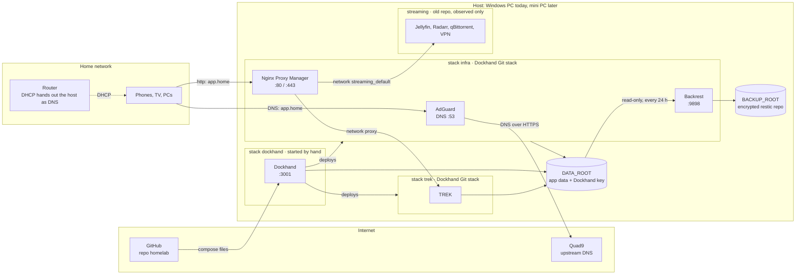

# homelab

Git-versioned definition of a personal homelab made of independent Docker Compose stacks. Built to move from the current Windows PC to an always-on mini PC (Linux, or a Linux VM on Proxmox) with a routine procedure.

## Architecture



Recipes live in Git, secrets in Dockhand, data in `DATA_ROOT`. Keep this diagram in sync with `stacks/` (see `AGENTS.md`).

## Layout

```text
stacks/
  dockhand/ # the stack manager; the only stack started by hand
  infra/    # AdGuard (DNS), Nginx Proxy Manager, Backrest; creates the `proxy` network; managed by Dockhand
  media/    # planned: Jellyfin, *arr, qBittorrent, VPN
  trek/     # TREK travel planner; first Git stack (pilot)
  photos/   # planned: Immich candidate
  paas/     # planned: Coolify/Dokploy, on its own host/VM, not managed by Dockhand
hosts/
  example.env   # template for host-specific values; real files stay private
```

Each stack folder holds:

- `compose.yaml`: pinned image versions, variables only, no secrets, no host paths.
- `.env.example`: variable names with safe example values (when the stack needs any).
- `README.md`: what data it owns and how to back it up and restore it.

## Layers

| Layer | Location | In Git |
| --- | --- | --- |
| Definition | `stacks/<name>/` | Yes |
| Secrets | Dockhand per-stack variables (encrypted in its database); host file only for `dockhand/` | Never |
| Application data | `${DATA_ROOT}/<stack>/` bind mounts | No; per-stack backups |
| Bulk media | `${MEDIA_ROOT}` on a separate disk | No; moved or copied directly |

## Rules

- Paths, `PUID`/`PGID` and `TZ` come from the host file. A missing variable fails (`${VAR:?...}`) instead of falling back to a path.
- Bind mounts under `DATA_ROOT`, not anonymous volumes: copying a folder copies a stack's state.
- Every Compose file sets `name:` so the project name does not depend on its folder.
- Services are reached by hostname through the reverse proxy and local DNS, not `IP:port`.
- No Docker Desktop–only features (`host.docker.internal`, Windows paths, named pipes).
- One manager per stack: Dockhand manages everything except itself (`dockhand/`, by hand) and `paas/` (its own platform).
- Dockhand holds the Docker socket (root-equivalent): reachable only over LAN/Tailscale with authentication, never from the internet.

## Management

- **Dockhand** (`stacks/dockhand`) is the control panel. Each other stack is registered as a Git stack pointing at `stacks/<name>/compose.yaml`; host values and secrets are Dockhand stack variables. Change a Compose file, push, then sync/redeploy in Dockhand.
- **Homarr** is an optional later portal with links and read-only widgets.

## Moving to a new host

1. Install Docker; clone this repository.
2. Create `hosts/<host>.env` from `hosts/example.env`.
3. Restore `${DATA_ROOT}` from backup (includes Dockhand's data and secret key); attach or copy `${MEDIA_ROOT}`.
4. Start `stacks/dockhand` by hand, then deploy `infra` and every other stack from Dockhand.
5. Repoint local DNS to the new host; verify every stack before retiring the old one.

A stack is migration-ready only after it has been restored from backup at least once.
