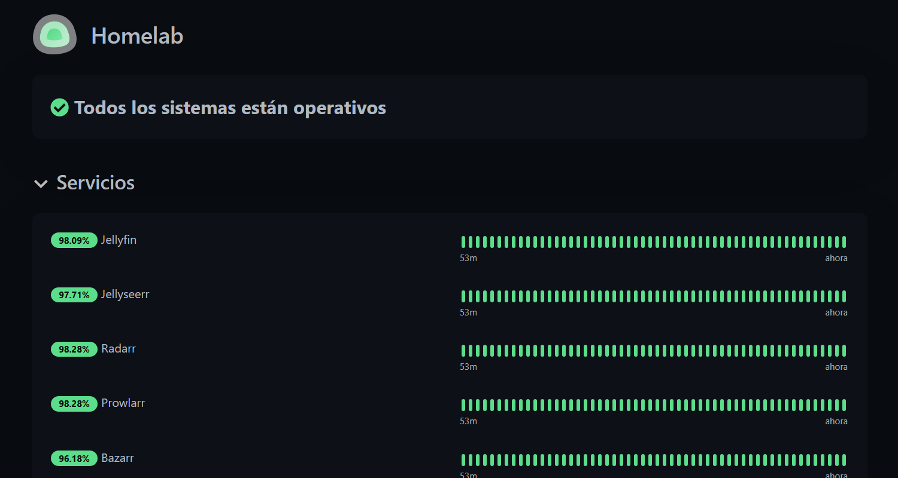

# homelab

A personal homelab built as **independent Docker Compose stacks, versioned in Git and deployed by [Dockhand](https://github.com/Finsys/dockhand)**. Every app is reached by a friendly name (`jellyfin.casa.home`) from any device at home, behind one shared login. The whole setup is designed to move from today's Windows PC to an always-on mini PC by copying one folder.

<picture>
  <source media="(prefers-color-scheme: dark)" srcset="docs/architecture-dark.png">
  
</picture>

## Highlights

- **Git is the source of truth.** Each stack is a folder with one `compose.yaml`. Dockhand pulls it from GitHub and deploys it, and secrets stay encrypted in Dockhand, never in Git.
- **Names, not ports.** AdGuard answers every `*.casa.home` name with the server's address. Nginx Proxy Manager then sends each name to the right container.
- **One login for everything.** Tinyauth sits in front of the admin UIs. Their own logins are switched off and their ports listen only on `127.0.0.1`, so nobody on the network can go around it.
- **Downloads only through the VPN.** qBittorrent has no network of its own: it shares Gluetun's, and Gluetun only lets traffic out through the ProtonVPN WireGuard tunnel. A sidecar keeps the forwarded port in sync.
- **Watched and backed up.**
  - Uptime Kuma checks 17 services every minute.
  - Beszel keeps CPU, memory and GPU history for the host and each container.
  - Backrest makes encrypted, deduplicated backups of all app data every night to a second disk.
- **Portable by design.** Compose files hold no host paths: every path comes from a variable (`DATA_ROOT`, `MEDIA_ROOT`, `BACKUP_ROOT`).

## Screenshots

The portal (Homepage with a custom glass theme): every app, its status and live numbers. The ⓘ on each card opens a panel explaining the app, its stack and its login.


The public status page from Uptime Kuma:



## What happens when you open an app

1. A phone asks the home DNS (**AdGuard**) for `radarr.casa.home`. A wildcard rule answers with the server's LAN address.
2. The browser connects to **Nginx Proxy Manager** on port 80. It maps the name to a container on the shared Docker network `proxy`.
3. Before forwarding, Nginx asks **Tinyauth** whether the browser has a valid session (`auth_request`). If not, it redirects to `auth.casa.home` and comes back after the login. The session cookie covers all of `casa.home`, so you log in once.
4. The request reaches **Radarr**, whose own login is off. Its port listens only on `127.0.0.1`, so the only way in from the network is through steps 2 and 3.

Jellyfin, Jellyseerr and TREK keep their own accounts, because TV apps and other people use them. PairDrop is open to every device at home.

## Stacks

| Stack | Services | What it is for |
| --- | --- | --- |
| [`dockhand`](stacks/dockhand) | Dockhand | The control panel: deploys every other stack from Git. The only stack started by hand. |
| [`infra`](stacks/infra) | AdGuard Home, Nginx Proxy Manager, Tinyauth, Backrest | Shared by everything: DNS, names, the login and backups. |
| [`media`](stacks/media) | Jellyfin, Jellyseerr, Radarr, Prowlarr, Bazarr, Byparr, qBittorrent, Gluetun, qbit-gluetun-sync | Films: request, find, download through the VPN, add subtitles, watch on any screen. |
| [`monitoring`](stacks/monitoring) | Uptime Kuma, Beszel (hub, agent, socket proxy) | Is it up, and what is using the machine. Kept separate so it survives other stacks' redeploys. |
| [`portal`](stacks/portal) | Homepage | One page with every app. Configured entirely inline in `compose.yaml`, custom CSS and JS included. |
| [`tools`](stacks/tools) | PairDrop, Stirling-PDF, Neko | Send files between devices, work on PDFs locally, and a shared browser streamed over WebRTC. |
| [`trek`](stacks/trek) | TREK | Travel planning: days, places, bookings, budget and packing. It also exposes an MCP endpoint. |

Each folder has a README with its variables, the data it owns, how it is backed up and a dated checklist of what has been verified.

## Design decisions

- **Independent stacks over one big Compose file.** Each stack can be redeployed, stopped or moved on its own. Shared pieces (DNS, proxy, login) live in `infra`. Monitoring is separate so it keeps watching while other stacks restart.
- **A ready-made manager, not custom tooling.** An earlier version of this project was a hand-built control panel. Dockhand already does Git deploys, encrypted per-stack variables and logs, so the custom code was retired.
- **Secrets never touch Git.** Compose files refer to `${VARIABLES}`. Real values sit in Dockhand, encrypted, and in one private host file for Dockhand itself.
- **Pinned images.** Every image uses a fixed version or digest, so a redeploy never pulls a surprise.
- **Guard rails learnt the hard way.**
  - Every container caps its logs at 3 × 10 MB.
  - Services that can spike (TREK, Neko, Byparr) are limited to 2 CPU cores, after a runaway process once starved the proxy and the login.
  - Gluetun's health check waits up to 2 minutes, so qBittorrent never starts before the VPN is up.
- **Backups of data, not of configuration exports.** Backrest copies all of `DATA_ROOT`, which holds every app database. A restore test checked the restored files byte by byte.

## Repository layout

```text
stacks/<name>/
  compose.yaml   # pinned images, variables only: no secrets, no host paths
  .env.example   # variable names with safe example values (when needed)
  README.md      # variables, data, backup and a dated checklist
hosts/
  example.env    # template for host-specific values; real host files stay private
docs/
  architecture.html   # self-contained source of the diagram (open it in a browser)
  *.png               # diagram and screenshots used in this README
```

On the host, the repository, data and media share one folder. Backups go to another disk:

```text
homelab/
  repo/    # this repository
  data/    # DATA_ROOT: app databases and settings, Dockhand's encrypted secrets
  media/   # MEDIA_ROOT: downloads and films
backups/   # BACKUP_ROOT, on a different disk
```

## Running it

1. Install Docker and create the shared network once: `docker network create proxy`.
2. Copy `hosts/example.env` to `hosts/<host>.env` and set the paths.
3. Start Dockhand by hand from `stacks/dockhand` (see its README), then register each stack in it as a Git stack (`stacks/<name>/compose.yaml`) with its variables.
4. Deploy `infra` first, then the rest. Point the router's DHCP DNS at the server, and add an AdGuard rewrite `*.home → <server IP>`.

Each stack README lists its own variables and first-start steps.

## Moving to a new host

1. Stop every stack on the old host.
2. Copy the homelab folder, or clone this repository and restore `data/` from backup. The backup includes Dockhand's database and its secret key.
3. Create `hosts/<host>.env`, start Dockhand, update `DATA_ROOT` / `MEDIA_ROOT` / `BACKUP_ROOT` on each stack, and deploy `infra` first.
4. Point the router's DNS and the AdGuard rewrite at the new host, and verify every stack before retiring the old one.

## Limitations and what is next

- **It runs on a desktop PC for now.** Everything stops when the PC is off. Host networking (needed by Home Assistant) and some DNS details work differently on Docker Desktop. The plan is a Linux mini PC.
- **Plain HTTP inside the home network.** HTTPS through Tailscale would unlock Vaultwarden and remote access.
- **Backups.** Copies sit on a second disk only: an offsite copy is still to do. A full restore of Dockhand (secrets decrypting on a fresh install) is also still to test.

| Next | Waits for |
| --- | --- |
| Tailscale for remote access to `*.casa.home` | Subnet route and DNS setup |
| Vaultwarden (homelab passwords) | HTTPS (Tailscale certificates) |
| Local AI: Ollama with offline Wikipedia (Kiwix) | GPU passthrough already verified on this host; needs more Docker memory |
| [Cobalt](https://github.com/imputnet/cobalt) media downloader (`tools`) | Packaging and access checks |
| Immich (photos) | Photo storage and an offsite backup |
| Home Assistant (WiZ lights, HomePod) | The mini PC (host networking) |

## Conventions

Working rules for changes are in [`AGENTS.md`](AGENTS.md). In short:
- validate Compose before committing;
- keep the architecture diagram in sync;
- never commit secrets or host files.
