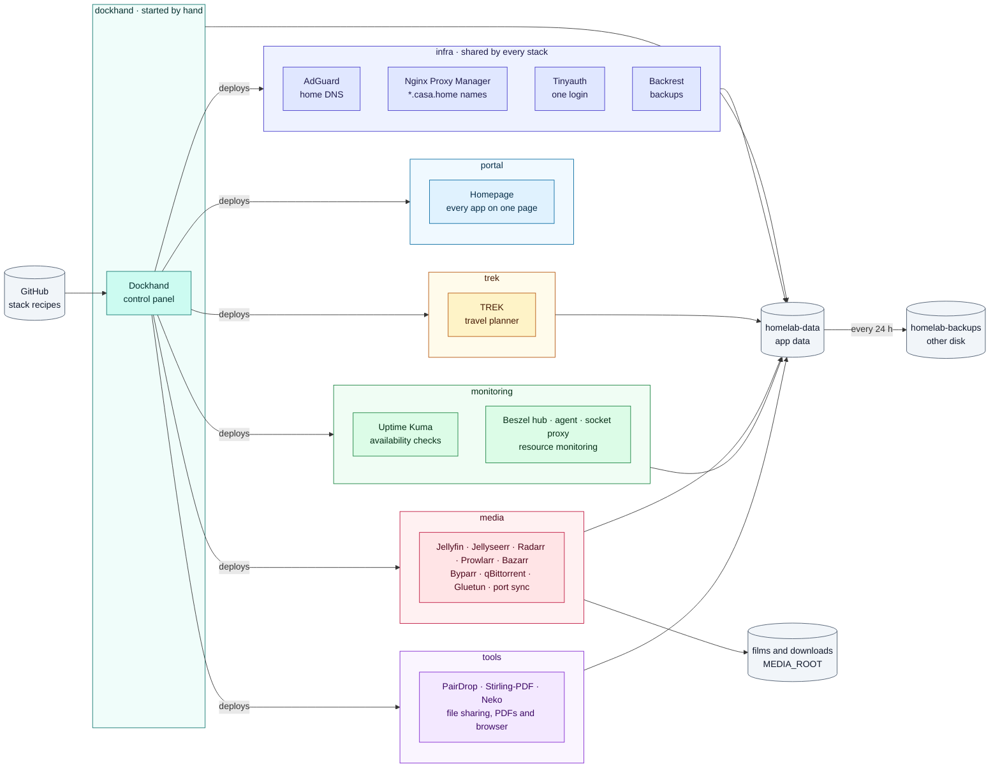

# homelab

Git-versioned definition of a personal homelab made of independent Docker Compose stacks. Built to move from the current Windows PC to an always-on mini PC (Linux, or a Linux VM on Proxmox) with a routine procedure.

## Architecture



One color per stack. Recipes live in Git, secrets in Dockhand, data in `homelab-data` (`DATA_ROOT`), copies in `homelab-backups` (`BACKUP_ROOT`). Network details (DNS, `*.casa.home`, the shared login, Docker networks) are in `stacks/infra/README.md`. Keep this diagram in sync with `stacks/` (see `AGENTS.md`).

## Layout

```text
stacks/
  dockhand/ # the stack manager; the only stack started by hand
  infra/    # AdGuard, Nginx Proxy Manager, Tinyauth and Backrest; uses the shared `proxy` network
  media/    # Jellyfin, Jellyseerr, Radarr, Prowlarr, Bazarr, qBittorrent behind ProtonVPN
  trek/     # TREK travel planner; first Git stack (pilot)
  monitoring/ # Uptime Kuma and Beszel; separate so monitoring survives other stacks' redeploys
  portal/   # Homepage: every app on one page; its configuration is inline in compose.yaml
  tools/    # PairDrop, Stirling-PDF and Neko
  photos/   # planned: Immich candidate
  paas/     # planned: Coolify/Dokploy, on its own host/VM, not managed by Dockhand
hosts/
  example.env   # template for host-specific values; real files stay private
```

On the current host, the repository, application data and media live under one folder; backups are on a separate disk:

```text
E:\homelab\            (/srv/homelab on Linux)
  repo\     # this repository
  data\     # DATA_ROOT: app data, Dockhand's encrypted secrets
  media\    # MEDIA_ROOT: downloads/ and media/ (films)
C:\homelab-backups\    # BACKUP_ROOT: deliberately on another disk
```

Each stack folder holds:

- `compose.yaml`: pinned image versions, variables only, no secrets, no host paths.
- `.env.example`: variable names with safe example values (when the stack needs any).
- `README.md`: what data it owns and how to back it up and restore it.

## Layers

| Layer | Location | In Git |
| --- | --- | --- |
| Definition | `stacks/<name>/` | Yes |
| Secrets | Dockhand per-stack variables (encrypted in its database); host file only for `dockhand/` | Never |
| Application data | Bind mounts under `${DATA_ROOT}` (paths vary by stack) | No; `DATA_ROOT` backup plan |
| Bulk media | `${MEDIA_ROOT}` on a separate disk | No; moved or copied directly |

## Rules

- Host-specific paths and settings come from the host file or Dockhand stack variables. Required paths and secrets use `${VAR:?...}`; some settings, including `PUID`, `PGID` and `TZ`, have defaults in Compose.
- Persistent application state uses bind mounts under `DATA_ROOT`; media files use `MEDIA_ROOT`. The `media` stack also has a named `gluetun_port` volume for VPN port synchronization.
- Every Compose file sets `name:` so the project name does not depend on its folder.
- Every service caps its logs (3 x 10 MB; most use `logging: *logging`): Docker keeps container logs forever by default.
- Services that can spike (TREK, Neko, Byparr) get `cpus: 2`: on 2026-11-16 TREK took 12 cores and every other stack, npm and Tinyauth included, stopped answering.
- Services are reached by hostname through the reverse proxy and local DNS, not `IP:port`. Web UIs protected by Tinyauth publish their port on `127.0.0.1` only, so the LAN cannot bypass the login.
- No Docker Desktop–only features (`host.docker.internal`, Windows paths, named pipes).
- One manager per stack: Dockhand manages everything except itself (`dockhand/`, by hand) and `paas/` (its own platform).
- Dockhand holds the Docker socket (root-equivalent): reachable only over LAN/Tailscale with authentication, never from the internet.

## Management

- **Dockhand** (`stacks/dockhand`) is the control panel. Each other stack is registered as a Git stack pointing at `stacks/<name>/compose.yaml`; host values and secrets are Dockhand stack variables. Change a Compose file, push, then sync/redeploy in Dockhand.
- **Portal** (`stacks/portal`, `portal.casa.home`): Homepage, configured in Git. Read-only: links, status and widgets; it never changes a stack.

## Roadmap

Planned, not deployed. Choose the appropriate stack when implementation starts.

| Item | Status | Waits for |
| --- | --- | --- |
| [Cobalt](https://github.com/imputnet/cobalt) (candidate for `tools`) | Planned | Self-host both the web frontend and processing API; verify Docker packaging, local proxy/Tinyauth and browser-to-API access, platform compatibility and any required cookies before deployment. No public exposure |
| Vaultwarden (`vault`), homelab passwords only | Planned | HTTPS: Bitwarden clients refuse plain HTTP; serve it through Tailscale HTTPS or a trusted local certificate |
| Tailscale (remote access to `*.casa.home`) | Client installed on the Windows host | Subnet route or DNS setup |
| Immich (`photos`) | Postponed | Photo storage location and an offsite backup (photos are irreplaceable) |
| Home Assistant (`home`) + extras (Mushroom, Bubble Card, Adaptive Lighting, Powercalc) | Postponed | Mini PC: needs host networking for device discovery (WiZ, HomeKit), which Docker Desktop on Windows does not give |
| Zigbee2MQTT | Only if Zigbee devices are bought | Home Assistant and a USB Zigbee adapter |
| Offsite backup copy | Pending | Destination choice |

## Configuration and recovery

Application settings, databases and Dockhand's encrypted variables live under `DATA_ROOT` and are covered by the documented Backrest plan. Git contains Compose definitions and examples, not a copy of the live configuration. Restore verification and offsite-copy limitations are described in `stacks/infra/README.md` and `stacks/dockhand/README.md`.

## Moving to a new host

1. Install Docker. Stop every stack on the old host.
2. Copy the homelab folder (`repo`, `data`, `media`), or clone the repository and restore `data` from backup (it includes Dockhand's data and secret key).
3. Create `hosts/<host>.env` from `hosts/example.env` with the new paths.
4. Create the shared network once (`docker network create proxy`), start `stacks/dockhand` by hand; in Dockhand, update `DATA_ROOT` / `MEDIA_ROOT` / `BACKUP_ROOT` on each stack and deploy `infra` first, then the rest.
5. Repoint local DNS to the new host (router DHCP and the AdGuard `*.home` rewrite, which covers `*.casa.home`); verify every stack before retiring the old one.

The documented restore test verified file contents only; starting restored Dockhand and confirming its secrets decrypt remains pending. An offsite backup is also pending. A stack is migration-ready only after it has been restored from backup and verified at least once.
